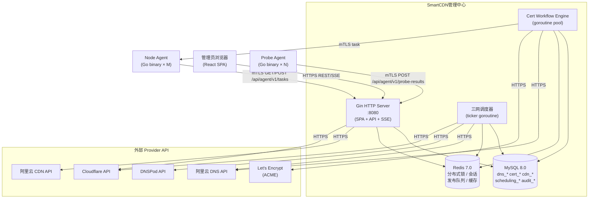
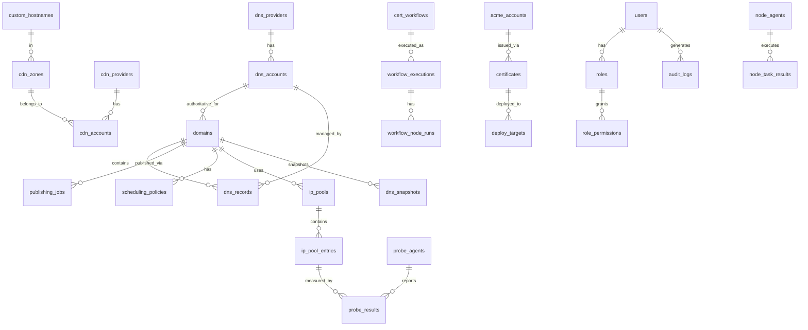
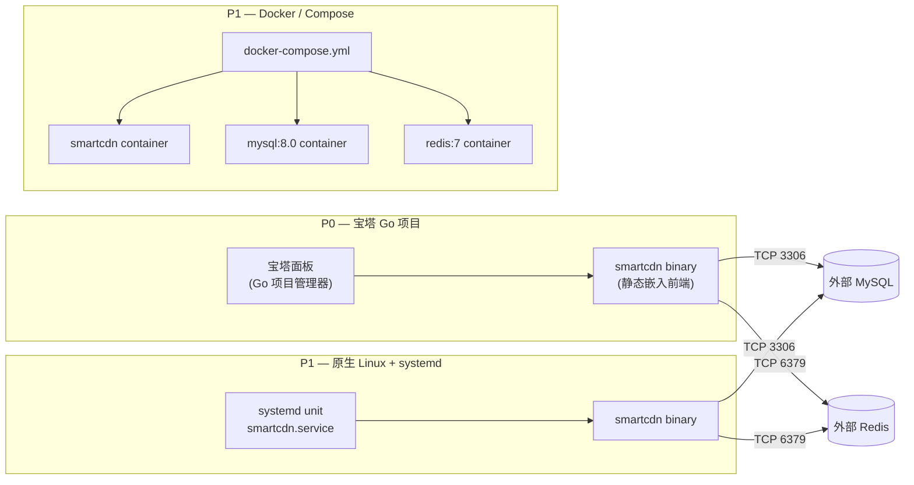

# Architecture Spine — SmartCDN

## Design Paradigm

**六边形架构（Hexagonal / Ports-and-Adapters）**，三层叠加：

```
┌─────────────────────────────────────────────────────────────────┐
│  Presentation Layer  (Gin HTTP handlers, WebSocket/SSE, CLI)    │
├─────────────────────────────────────────────────────────────────┤
│  Application Layer   (Service / Use-case orchestrators)         │
│  ┌──────────────┐  ┌───────────────┐  ┌────────────────────┐   │
│  │  DNS Service │  │  CDN Service  │  │  SSL/Cert Service  │   │
│  │  Scheduler   │  │  Node Service │  │  Workflow Engine   │   │
│  └──────────────┘  └───────────────┘  └────────────────────┘   │
├─────────────────────────────────────────────────────────────────┤
│  Domain Layer        (Entities, Value Objects, Domain Events)   │
│  Provider Port interfaces live HERE — zero external imports     │
├──────────────┬──────────────────────────────────────────────────┤
│  Infra Layer │ DNS Adapters: AliyunDNS · DNSPod · CloudflareDNS │
│  (Adapters)  │ CDN Adapters: CloudflareSaaS · AliyunCDN         │
│              │ Deploy Targets: BaotaNG · NativeNginx · SSHDeploy│
│              │ Persistence: MySQL (GORM) · Redis (go-redis)     │
│              │ ACME: go-acme/lego                               │
└──────────────┴──────────────────────────────────────────────────┘
```

**映射到目录：**

```
internal/
  domain/        # 实体、值对象、端口接口（Port）——零外部依赖
  application/   # 用例编排（Service）——只依赖 domain/
  infra/
    provider/    # DNS/CDN Provider 适配器（Adapter）
    deploy/      # 证书部署目标适配器
    persistence/ # MySQL repository 实现
    cache/       # Redis 实现
    acme/        # go-acme/lego 包装器
  handler/       # Gin HTTP handler / WebSocket / SSE
  agent/         # Probe Agent 和 Node Agent（独立 binary）
cmd/
  smartcdn/      # 主服务入口
  probe-agent/   # Probe Agent 入口
  node-agent/    # Node Agent 入口
```

---

## Invariants & Rules

### AD-1 — Provider Port 接口是 domain 层的唯一契约

- **Binds:** F3 F4 F7 F8 F9（全部 Provider 相关功能）
- **Prevents:** Application 层直接 import infra/provider/\* 包；core 调度代码因增加 Provider 而修改
- **Rule:** `internal/domain/port/` 中定义三组 Port 接口（`DNSProvider`、`CDNProvider`、`DeployTarget`）。Application 层和 Domain 层只依赖这些接口。Infra 层适配器实现接口，注册到 Registry。调度器通过 `ProviderRegistry.Get(providerID)` 获取实例，不 import 任何具体适配器包。

---

### AD-2 — DNS Provider 接口方法集（Port 契约）

- **Binds:** F3 F4 FR-9 FR-13 FR-14 FR-15
- **Prevents:** 适配器自定义 API 形状导致 Application 层出现 type-switch
- **Rule:** 所有 DNS Provider 适配器必须实现以下 Go 接口（版本 v1）：

```go
type DNSProvider interface {
    ProviderMeta() ProviderMeta                            // 名称/版本/能力声明
    ValidateCredentials(ctx, creds Credentials) error
    DetectCapabilities(ctx, creds Credentials) (Capabilities, error)
    ListZones(ctx) ([]Zone, error)
    ListRecords(ctx, zoneID string) ([]Record, error)
    CreateRecord(ctx, zoneID string, r RecordInput) (Record, error)
    UpdateRecord(ctx, zoneID, recordID string, r RecordInput) (Record, error)
    DeleteRecord(ctx, zoneID, recordID string) error
    EnableRecord(ctx, zoneID, recordID string) error
    DisableRecord(ctx, zoneID, recordID string) error
    GetNameservers(ctx, zoneID string) ([]string, error)
    GetLimits(ctx) (Limits, error)
    VerifyPropagation(ctx, fqdn, recordType, expected string, timeout time.Duration) error
    CreateBatch(ctx, zoneID string, ops []BatchOp) (BatchResult, error)
}
```

不支持的方法返回 `UnsupportedCapabilityError`，不返回 nil 或 panic。

---

### AD-3 — CDN Provider 接口方法集

- **Binds:** F7 F8 F9 FR-27 through FR-36
- **Prevents:** CDN 功能直接调用 Cloudflare/Aliyun SDK 包
- **Rule:** 所有 CDN Provider 适配器实现：

```go
type CDNProvider interface {
    ProviderMeta() ProviderMeta
    ValidateCredentials(ctx, creds Credentials) error
    DetectCapabilities(ctx, creds Credentials) (CDNCaps, error)
    ListZones(ctx) ([]CDNZone, error)
    // Cloudflare SaaS 子接口（仅 CF 适配器实现）
    CloudflareSaaS() (CloudflareSaaSProvider, error) // 不支持时返回 UnsupportedCapabilityError
}

type CloudflareSaaSProvider interface {
    ListCustomHostnames(ctx, zoneID string) ([]CustomHostname, error)
    CreateCustomHostname(ctx, zoneID string, in CustomHostnameInput) (CustomHostname, error)
    GetCustomHostname(ctx, zoneID, hostnameID string) (CustomHostname, error)
    DeleteCustomHostname(ctx, zoneID, hostnameID string) error
    RetriggerDCV(ctx, zoneID, hostnameID string) error
}
```

---

### AD-4 — Deploy Target 接口方法集

- **Binds:** F12 FR-45 through FR-50
- **Prevents:** 证书工作流直接调用宝塔 API 或 SSH 命令
- **Rule:**

```go
type DeployTarget interface {
    TargetMeta() TargetMeta
    ValidateConnection(ctx) error
    HealthCheck(ctx) error
    DeployCertificate(ctx, in CertDeployInput) (CertDeployResult, error)
    RollbackCertificate(ctx, deployID string) error
    VerifyDeployment(ctx, domain string) (TLSCheckResult, error)
}
```

`CertDeployInput` 包含 `PEM`（cert chain）、`PrivateKeyEncrypted`（AES-256-GCM，解密在适配器内完成）和 `Domain`。

---

### AD-5 — DNS 安全发布：13 步原子流程

- **Binds:** F6 F10 FR-20 FR-21 FR-22 UJ-2
- **Prevents:** 任何代码绕过此流程直接写 DNS；单步失败后遗留半更新状态
- **Rule:** 所有向权威 DNS 写入记录的操作必须经过 `DNSPublishJob` 编排，严格执行以下 13 步：

```
1.  拍快照     — 读取当前记录集到 dns_snapshots
2.  获取锁     — Redis SETNX key=dns_lock:{domainID}:{line}，TTL=10min
3.  幂等检查   — 目标状态与当前状态比较，相同则短路返回 NO_OP
4.  Dry Run   — Provider.CreateBatch(ops, dryRun=true)，校验计划
5.  套餐校验   — 验证记录条数不超过 Limits.MaxRecordsPerSet
6.  创建/更新  — Provider.CreateBatch(ops) 或逐条 Create/Update
7.  权威验证   — VerifyPropagation 轮询权威 NS（非递归查询）
8.  外部检查   — 对每个新 IP 执行 HTTPS 健康检查（防止空记录上线）
9.  写结果     — publishing_jobs 更新状态=SUCCEEDED
10. 释放锁     — Redis DEL
11. 记录审计   — audit_logs 写入前后状态
12. 更新 IP 池  — ip_pools 状态更新为 Published
13. 触发通知   — 推送告警/Webhook

失败路径：步骤 6 之后失败 → 执行回滚（从 dns_snapshots 恢复）→ 步骤 9'写 FAILED → 10 释放锁 → 11 记录审计 → 13 推送告警
```

---

### AD-6 — 分布式锁保护 DNS 变更

- **Binds:** F6 F10 FR-22 UJ-2
- **Prevents:** 同一域名同一线路同时发起两次发布操作导致状态竞争
- **Rule:** 获取 Redis 分布式锁后才能进入发布步骤 4–8。锁 key = `dns_lock:{domainID}:{line}`，TTL = 10min（发布操作最大超时）。锁必须由同一进程释放（Lua 脚本 CAS）。等待锁超时返回 `LockContentionError`，调用方放弃本次轮次等待下一周期。

---

### AD-7 — 证书工作流 DAG 引擎

- **Binds:** F12 FR-43 FR-44 FR-45
- **Prevents:** 证书申请/续期/部署逻辑耦合为单一函数；无法并行执行部署分支
- **Rule:** 证书工作流以 DAG 结构存储在 `cert_workflows` 表（节点 JSON 列）。执行引擎（`workflow.Engine`）遍历 DAG，对每个节点：
  - 计算所有前置依赖节点是否 SUCCEEDED
  - 满足则异步执行节点 Handler（Go goroutine）
  - 节点类型：`AcmeOrder`、`DnsChallenge`、`AcmeVerify`、`DownloadCert`、`DeployTarget`、`NotifySuccess`、`NotifyFailure`、`Condition`
  - 执行结果写入 `workflow_node_runs`
  - 失败节点：按节点 `retryPolicy` 重试；超限后标记 FAILED，触发回滚分支（若存在）
  - 引擎使用 `go-acme/lego` 执行 ACME 操作（`acme.Client`）

---

### AD-8 — 凭证与私钥加密：AES-256-GCM

- **Binds:** F1 F3 FR-3 FR-12 FR-44 全部凭证存储
- **Prevents:** 明文凭证或私钥落库；密钥硬编码进代码
- **Rule:** 加密密钥从环境变量 `SMARTCDN_ENCRYPT_KEY`（32 字节 hex）读取，启动时验证格式。每条加密记录使用独立随机 nonce（12 字节），密文格式 = `nonce(12) || ciphertext`，Base64 存储。解密在 Infra 层（`infra/crypto/`）执行，Domain 层和 Application 层只处理明文。日志中任何字段值若匹配凭证模式（长度>16 字节的随机 hex/base64）必须被 `sanitize` 处理器屏蔽。

---

### AD-9 — RBAC 权限粒度至 API Endpoint

- **Binds:** F2 FR-6 全部受保护 API
- **Prevents:** 细粒度权限不一致；角色变更需重启生效
- **Rule:** 权限模型：`Role → Permission[]`，`Permission = {resource, action}`，resource 对应路由组（如 `dns:records`），action 为 `read|write|delete`。Gin middleware `RequirePermission(resource, action)` 在每个路由上注册。权限表缓存在 Redis（TTL 5min），角色变更后 Pub/Sub 触发各节点清除缓存，实时生效（≤5s 传播延迟）。越权返回 403，不返回 404。

---

### AD-10 — Probe Agent：mTLS 双向认证 + 独立 Binary

- **Binds:** F10 FR-37 FR-38 UJ-2
- **Prevents:** 伪造探针上报数据污染 IP 评分；探针直接访问数据库
- **Rule:** Probe Agent 是独立编译的 Go binary（`cmd/probe-agent/`），通过 mTLS 向管理中心的 `/api/agent/v1/probe-results` 上报数据。管理中心为每个 Agent 颁发客户端证书（CA 签名）。Agent 只能调用上报 API，无法访问其他管理接口。Agent 配置（目标 IP 列表、探测频率）由管理中心下发（Pull 模式，Agent 定期 GET `/api/agent/v1/config`）。

---

### AD-11 — Node Agent：mTLS + 受限任务执行

- **Binds:** F9 FR-35
- **Prevents:** 节点 Agent 被利用执行任意命令（SSRF / RCE）
- **Rule:** Node Agent 是独立 Go binary（`cmd/node-agent/`），mTLS 认证。只执行管理中心下发的白名单任务类型：`reload_nginx`、`deploy_cert`、`check_https`。任务队列通过 Redis Pub/Sub 或 Agent 轮询获取。任务执行结果回写 `node_task_results`。Agent 不接受任意 shell 命令。

---

### AD-12 — 三网调度：评分 → 熔断 → DNS 发布

- **Binds:** F10 FR-37 FR-39 FR-40 UJ-2
- **Prevents:** 单点评分函数不一致；无限制切换导致 DNS TTL 未过期的"闪切"
- **Rule:** 调度 goroutine 以可配置间隔（默认 10min）运行，对每条 `{domainID, line}` 组合：
  1. 聚合各 Probe Agent 最近 N 次探测结果（延迟权重 40%、TTFB 权重 40%、成功率权重 20%）
  2. 对候选 IP 排序，检查 Published Set 是否需要更换
  3. **熔断条件**：30min 内同线路切换 ≥ 3 次 → 暂停自动调度，告警
  4. 需要切换时：从 Eligible Pool 选取备用 → 通过 AD-5（13 步）发布
  5. 结果写入 `scheduling_runs`

---

### AD-13 — 状态机：Publishing Job 状态转换

- **Binds:** F6 F10 FR-21 FR-22
- **Prevents:** 状态跳跃导致孤悬 RUNNING 记录；UI 展示不一致状态
- **Rule:** `publishing_jobs.status` 合法转换：

```
PENDING → RUNNING → SUCCEEDED
PENDING → RUNNING → FAILED → (可重试) PENDING
PENDING → CANCELLED
```

只有 Application 层的 `PublishingJobService` 可以写 `status` 字段，Repository 不直接更新状态。UI 只读此字段，不做本地推断。

---

### AD-14 — 安装锁：install.lock 控制安装接口可访问性

- **Binds:** F1 FR-1 FR-2
- **Prevents:** 安装接口在生产环境被重放调用
- **Rule:** 启动时检查 `{data_dir}/install.lock` 存在性。若存在，所有 `POST /api/v1/setup/*` 路由返回 403。安装流程最后一步写入 `install.lock`，只有 Migration 和管理员账号创建均成功后才写。`install.lock` 只包含安装时间戳，不包含密钥。

---

### AD-15 — 审计日志：不可变，无软删除

- **Binds:** F2 FR-7 全部写操作
- **Prevents:** 操作历史被篡改或删除
- **Rule:** `audit_logs` 表没有 `deleted_at` 列，Application 层不提供删除审计日志的 Service 方法，API 层不暴露删除端点。审计日志由 Gin middleware `AuditLogger` 在请求完成后异步写入（不阻塞响应）。写入字段：`operator_id`、`operator_ip`、`action`、`resource_type`、`resource_id`、`before_state`（JSON 摘要，≤4KB）、`after_state`（JSON 摘要，≤4KB）、`created_at`。

---

### AD-16 — 前端：单一 SPA，CSR，Vite 构建

- **Binds:** 全部前端模块
- **Prevents:** 前端与后端 API 版本耦合；SSR 引入与宝塔 Go 项目不兼容的 Node 运行时
- **Rule:** 前端为纯静态 SPA（Vite + React 18 + TypeScript），构建产物为 `dist/` 下的 HTML/JS/CSS 文件，由 Go 后端通过 `embed.FS` 在 `/` 路由提供服务。API 请求走 `/api/v1/` 前缀，同域部署无 CORS 问题。不使用 SSR（Next.js 等）——宝塔 Go 项目只支持单一 Go binary。

---

### AD-17 — API 版本：/api/v1/ 前缀，Breaking Change 升 /api/v2/

- **Binds:** 全部 API 端点
- **Prevents:** 路由冲突；移动端/脚本客户端在无版本路由下静默失效
- **Rule:** 全部 API 路由以 `/api/v1/` 开头。Agent API 以 `/api/agent/v1/` 开头（mTLS 验证的独立路由组）。Setup API 以 `/api/v1/setup/` 开头（install.lock 控制）。Breaking Change（删除/重命名字段）不在 v1 修改，新建 `/api/v2/` 路由组共存过渡期。

---

### AD-18 — SSE/WebSocket：实时推送走独立端点

- **Binds:** F14 FR-53 FR-54（实时监控、任务进度）
- **Prevents:** 轮询大量端点增加不必要服务器负载；SSE 与 REST 路由混淆
- **Rule:** 实时更新通过两种机制：
  - **SSE**（服务端推送，单向）：`GET /api/v1/events` — 全局事件流（告警、任务状态变更）；`GET /api/v1/tasks/:id/log-stream` — 单任务日志流
  - **WebSocket**（双向）：仅工作流 DAG 执行进度（需双向交互）
  REST 轮询不作为实时更新的主路径。SSE 连接空闲 30s 发送 keepalive comment。

---

### AD-19 — SSRF 防护：出站 HTTP 请求必须经过白名单校验

- **Binds:** F3 F7 F12 全部 Provider API 调用 / Webhook / ACME 通信
- **Prevents:** 攻击者通过 Fallback Origin 配置触发对内网地址的请求
- **Rule:** `infra/httpclient/` 提供统一 HTTP 客户端，所有出站请求必须经过 `SSRFGuard.Check(url)` 验证。规则：拒绝 `localhost`、RFC1918 地址（10.0.0.0/8、172.16.0.0/12、192.168.0.0/16）、169.254.0.0/16、`0.0.0.0`、`[::]`；仅允许 HTTPS（除显式标记为测试环境的接口）。Provider SDK 不直接使用 `http.DefaultClient`，统一替换为受保护的 client。

---

### AD-20 — ICP 备案边界：控制大陆 CDN 节点可选性

- **Binds:** F7 F9 FR-30 FR-31 FR-32
- **Prevents:** 未备案域名被配置到大陆 CDN 节点违规上线
- **Rule:** `domains.icp_filed`（bool）字段控制 CDN 配置选项。当 `icp_filed=false` 时，所有大陆境内 CDN 节点（阿里云 CDN 大陆节点、自有大陆节点）在域名的可用 CDN 下拉中不显示，API 层亦拦截该组合并返回 `ICPViolationError`。香港、境外节点不受限制。

---

## Consistency Conventions

| Concern | Convention |
|---------|------------|
| **命名 — Go 包** | 所有包名小写单词，无下划线。`domain/`、`application/`、`infra/`、`handler/` 四大包层次严格分离 |
| **命名 — 数据库表** | `snake_case`，复数名词（`dns_records`、`publishing_jobs`）；外键列 `{table}_id`（如 `domain_id`） |
| **命名 — API 路由** | kebab-case（`/api/v1/dns-records`），资源名复数，ID 参数 `:id` |
| **命名 — React 组件** | PascalCase 文件和导出（`DnsRecordTable.tsx`），hooks 以 `use` 前缀 |
| **实体 ID** | 全部使用 `uint64` 自增主键（MySQL BIGINT UNSIGNED）；外部 API 返回时转为字符串（JSON number 精度安全） |
| **时间戳** | 数据库存 UTC DATETIME(3)，API 返回 RFC3339 字符串（`2026-11-09T12:00:00.000Z`），前端本地时区显示 |
| **错误格式** | API 错误统一 `{"code": "PROVIDER_API_ERROR", "message": "...", "details": {...}}`；`code` 为 ALL_CAPS_SNAKE 字符串；500 不暴露内部堆栈 |
| **日志字段** | `zap.Logger`，字段：`timestamp`、`level`、`module`、`request_id`、`user_id`（可选）、`message`、`error`（非空时）；禁止 `fmt.Println` |
| **配置来源** | 优先级：环境变量 > `config.yaml` > 内置默认值；`viper` 读取；绝不硬编码生产配置 |
| **软删除** | 除 `audit_logs` 外，所有业务表含 `deleted_at DATETIME NULL`；GORM `SoftDelete` plugin；查询默认过滤已删除行 |
| **状态字段** | 所有 `status` 枚举值在代码中定义为 `const` 字符串，不用裸字符串字面量 |
| **分页** | 列表 API 统一 cursor-based（`?cursor=&limit=`），不用 offset-based（大表性能问题） |
| **Provider 凭证传递** | Application 层向 Provider 传递 `Credentials{Raw map[string]string}`（已解密），Domain 层不关心加密 |
| **前端状态管理** | Zustand（全局 store：用户/权限/主题）；React Query（服务端数据 fetching/caching）；不用 Redux |
| **前端 API 调用** | Axios instance，统一 baseURL `/api/v1`，拦截器处理 401 跳转和错误 Toast |

---

## Stack

| Name | Version | Role |
|------|---------|------|
| Go | 1.23 | 后端主语言，所有服务端组件 |
| Gin | 1.9.x | HTTP 框架 |
| GORM | 2.x | ORM，MySQL 适配 |
| go-redis | 9.x | Redis 客户端 |
| go-acme/lego | 4.x | ACME 协议实现（Let's Encrypt / ZeroSSL） |
| zap | 1.27.x | 结构化日志 |
| viper | 1.18.x | 配置管理 |
| jwt-go (golang-jwt) | 5.x | JWT 认证 |
| wire | 0.6.x | 依赖注入（编译时） |
| React | 18.3.x | 前端框架 |
| TypeScript | 5.x | 前端类型系统 |
| Vite | 5.x | 前端构建工具 |
| Arco Design React | 2.x | UI 组件库 |
| Zustand | 4.x | 前端全局状态 |
| React Query (TanStack) | 5.x | 服务端状态管理 |
| Axios | 1.x | HTTP 客户端 |
| ECharts | 5.x | 图表库 |
| MySQL | 8.0+ | 主数据库 |
| Redis | 7.0+ | 缓存、分布式锁、消息队列、会话存储 |
| aliyun-go-sdk / alibabacloud-go-sdk | latest | 阿里云 DNS & CDN API |
| cloudflare-go | latest | Cloudflare DNS & SaaS API |
| DNSPod Go SDK | latest | DNSPod API v3 |

---

## Structural Seed

### 系统容器图



---

### 核心数据库 ERD（主要实体及关系）



---

### 主要数据库表（关键字段）

```sql
-- DNS 核心
dns_providers    (id, name, slug, version, status, deleted_at)
dns_accounts     (id, provider_id, name, credentials_enc, capabilities_json, 
                  status, last_checked_at, deleted_at)
domains          (id, name, authoritative_account_id, standby_account_id,
                  icp_filed, dry_run_mode, deleted_at)
dns_records      (id, domain_id, account_id, zone_id, type, host, value,
                  ttl, line, status, is_external, deleted_at)
dns_snapshots    (id, domain_id, account_id, snapshot_json, trigger,
                  created_at)  -- 无 deleted_at，只读

-- 发布与调度
publishing_jobs  (id, domain_id, line, job_type, status, ops_json,
                  snapshot_id, started_at, finished_at, error, created_at)
scheduling_runs  (id, domain_id, line, trigger, old_ips_json, new_ips_json,
                  status, circuit_broken, created_at)
scheduling_policies (id, domain_id, interval_seconds, circuit_breaker_threshold,
                     max_published_ips, auto_enabled, deleted_at)
ip_pools         (id, domain_id, line, deleted_at)
ip_pool_entries  (id, pool_id, ip, status, score, deleted_at)
probe_agents     (id, name, isp, region, cert_fingerprint, last_seen_at, deleted_at)
probe_results    (id, agent_id, ip, latency_ms, ttfb_ms, success, http_status,
                  probed_at)  -- 高写入表，分区或归档策略

-- CDN
cdn_providers    (id, name, slug, version, deleted_at)
cdn_accounts     (id, provider_id, name, credentials_enc, deleted_at)
cdn_zones        (id, account_id, zone_id_ext, name, plan, deleted_at)
custom_hostnames (id, zone_id, hostname, fallback_origin, dcv_type,
                  verification_status, ssl_status, deleted_at)

-- SSL / 证书
acme_accounts    (id, name, email, ca, key_pem_enc, deleted_at)
certificates     (id, domain, san_json, acme_account_id, issuer, status,
                  expires_at, cert_pem, chain_pem, private_key_enc, deleted_at)
deploy_targets   (id, name, target_type, config_enc, deleted_at)
cert_workflows   (id, name, dag_json, trigger_type, trigger_config,
                  enabled, deleted_at)
workflow_executions (id, workflow_id, certificate_id, status, started_at,
                     finished_at)
workflow_node_runs  (id, execution_id, node_id, node_type, status, log_text,
                     started_at, finished_at)

-- 认证与审计
users            (id, username, password_hash, deleted_at)
roles            (id, name, deleted_at)
user_roles       (user_id, role_id)
role_permissions (role_id, resource, action)
audit_logs       (id, operator_id, operator_ip, action, resource_type,
                  resource_id, before_state, after_state, created_at)
                  -- 无 deleted_at

-- 监控与告警
alert_rules      (id, name, condition_json, severity, enabled, deleted_at)
alert_records    (id, rule_id, resource_type, resource_id, message, status,
                  triggered_at, resolved_at)
notification_channels (id, name, channel_type, config_enc, deleted_at)
```

---

### 目录结构（骨架）

```text
smartcdn/
├── cmd/
│   ├── smartcdn/        # 主服务 main.go
│   ├── probe-agent/     # Probe Agent main.go
│   └── node-agent/      # Node Agent main.go
├── internal/
│   ├── domain/
│   │   ├── entity/      # DNS Record, Domain, Certificate, IPPool…
│   │   ├── port/        # DNSProvider, CDNProvider, DeployTarget 接口
│   │   └── event/       # 领域事件定义
│   ├── application/
│   │   ├── dns/         # DNS Service, Publishing Service
│   │   ├── cdn/         # CDN Service, Cloudflare SaaS Service
│   │   ├── ssl/         # Cert Service, Workflow Engine
│   │   ├── scheduling/  # Scheduler Service
│   │   └── auth/        # Auth Service, RBAC Service
│   ├── infra/
│   │   ├── provider/
│   │   │   ├── aliyundns/
│   │   │   ├── dnspod/
│   │   │   └── cloudflare/
│   │   ├── deploy/
│   │   │   ├── baotanginx/
│   │   │   ├── nativeng/
│   │   │   └── ssh/
│   │   ├── persistence/  # GORM repositories
│   │   ├── cache/        # Redis
│   │   ├── acme/         # go-acme/lego 包装
│   │   ├── crypto/       # AES-256-GCM 加解密
│   │   └── httpclient/   # SSRF-guarded HTTP client
│   ├── handler/
│   │   ├── api/          # REST handler 分模块
│   │   ├── agent/        # Agent API handler (mTLS)
│   │   ├── middleware/   # Auth, RBAC, Audit, CORS, CSP
│   │   └── sse/          # SSE event stream handler
│   └── agent/
│       ├── probe/        # Probe Agent 逻辑
│       └── node/         # Node Agent 逻辑
├── frontend/             # React SPA (Vite 项目根)
│   ├── src/
│   │   ├── pages/
│   │   ├── components/
│   │   ├── stores/       # Zustand stores
│   │   ├── queries/      # React Query hooks
│   │   └── api/          # Axios instance + generated types
│   └── dist/             # 构建产物（embed 进 Go binary）
├── migrations/           # SQL migration 文件（Flyway/goose）
├── configs/
│   ├── config.yaml       # 默认配置模板
│   └── config.example.yaml
├── deploy/
│   ├── docker/           # Dockerfile + docker-compose.yml
│   ├── systemd/          # smartcdn.service unit 文件
│   └── baota/            # 宝塔 Go 项目配置文档
└── docs/
    └── openapi/          # OpenAPI 3.1 spec
```

---

### 部署拓扑



**部署注意事项：**
- 所有三种部署形式使用同一 binary，区别仅在进程管理器和依赖服务提供方式
- P0 宝塔 Go 项目：单 binary，MySQL 和 Redis 通常为宝塔面板已托管的本机服务
- P1 Docker Compose：MySQL 和 Redis 作为 compose service 随应用一同启动
- `SMARTCDN_ENCRYPT_KEY` 环境变量三种模式均通过进程管理器注入，不写入代码或 Git

---

## Capability → Architecture Map

| FR / Area | Lives In | Governed By |
|-----------|----------|-------------|
| FR-1 ~ FR-4（安装/配置/日志） | `handler/api/setup/`, `infra/crypto/` | AD-14, AD-8 |
| FR-5 ~ FR-8（认证/RBAC/审计/CSRF） | `application/auth/`, `handler/middleware/` | AD-9, AD-15 |
| FR-9 ~ FR-12（Provider 框架/凭证） | `domain/port/`, `infra/provider/`, `infra/crypto/` | AD-1, AD-2, AD-8 |
| FR-13 ~ FR-15（DNS 适配器） | `infra/provider/aliyundns/`, `dnspod/`, `cloudflare/` | AD-2, AD-1 |
| FR-16 ~ FR-19（多域名/记录/快照） | `application/dns/`, `infra/persistence/` | AD-5, AD-13 |
| FR-20 ~ FR-22（DNS 迁移/发布引擎） | `application/dns/`, `infra/provider/` | AD-5, AD-6, AD-13 |
| FR-23 ~ FR-26（Multi-DNS/NS切换） | `application/dns/`, `handler/api/dns/` | AD-5, AD-6 |
| FR-27 ~ FR-32（CDN管理/Cloudflare SaaS/阿里云CDN） | `application/cdn/`, `infra/provider/cloudflare/`, `aliyundns/` | AD-3, AD-20 |
| FR-33 ~ FR-36（自有节点/缓存规则） | `application/cdn/`, `infra/deploy/` | AD-3, AD-4 |
| FR-37 ~ FR-41（调度/探针/IP池/熔断） | `application/scheduling/`, `cmd/probe-agent/` | AD-10, AD-12 |
| FR-42 ~ FR-44（SSL/ACME） | `application/ssl/`, `infra/acme/` | AD-7, AD-8 |
| FR-45 ~ FR-50（证书部署目标） | `infra/deploy/`, `cmd/node-agent/` | AD-4, AD-11 |
| FR-51 ~ FR-52（工作流DAG编辑器） | `handler/api/ssl/workflows/` | AD-7 |
| FR-53 ~ FR-55（监控/告警） | `application/monitoring/`, `handler/sse/` | AD-18 |
| FR-56 ~ FR-58（系统管理/备份） | `handler/api/admin/`, `application/admin/` | AD-9, AD-15 |
| Deployment | `deploy/` | AD-16, AD-17 |
| Agent 通信 | `cmd/probe-agent/`, `cmd/node-agent/`, `handler/agent/` | AD-10, AD-11 |

---

## Deferred

| 决策 | 理由 | 推迟到 |
|------|------|--------|
| DNS 记录字段级并发冲突解决策略 | Story 实现时决定（乐观锁 vs 应用层锁） | Epic 5–6 Story 设计 |
| Probe Agent 配置下发协议（Pull vs Push） | AD-10 规定了 Pull 模式，但推送频率和 diff 格式由 Story 细化 | Epic 10 |
| 工作流 DAG 执行引擎并发度限制 | 依赖实际负载测试数据 | Epic 12 |
| `probe_results` 高写入表分区/归档策略 | 决定于运营规模；初期单表，优化时加 | Epic 10 实现后 |
| 华为云 DNS 适配器（V2） | V2 路线图；AD-1 已确保无需修改核心 | V2 规划 |
| Tencent CDN 证书部署（V2） | V2 路线图 | V2 规划 |
| 多语言（i18n）后端 API 错误消息本地化 | V1 仅中文错误码，英文 message；国际化在 V2 | V2 规划 |
| 操作审计日志压缩归档 | 初期保留 90 天全量，归档策略待运营数据 | 上线后 |
| OpenAPI spec 自动生成（swaggo）vs 手写 | 团队偏好，不影响 API 契约 | Epic 2 Story 设计 |
| Redis 单节点 vs Cluster vs Sentinel | P0 宝塔部署通常为单节点，后续根据规模评估 | 运维阶段 |

---

## ADR 记录

### ADR-01：六边形架构 + Provider 插件接口

**决策：** 采用六边形架构，Provider 接口定义在 Domain 层，所有适配器实现 Port 接口，通过 ProviderRegistry 注入。

**理由（见 memlog）：** 项目的核心约束之一是"增加 Provider 不修改调度层代码"。六边形架构天然实现此目标：调度层通过 Port 接口调用 Provider，永远不 import 具体适配器包。

**后果：** 新增 Provider 只需在 `infra/provider/` 下新建包，注册到 Registry，无需改动 Application 层。测试时可注入 mock Provider。

---

### ADR-02：单 Binary 嵌入前端静态文件

**决策：** React SPA 构建产物通过 Go `embed.FS` 嵌入主 binary，由 Gin 的 `/` 路由提供服务。

**理由（见 memlog）：** 宝塔 Go 项目只管理单一 Go binary，不支持额外的静态文件服务器（Nginx）部署形式。单 binary 大幅简化宝塔部署的运维复杂性。

**后果：** 无 SSR；前端不能使用 Next.js 等需要 Node 运行时的框架；构建时 Vite 先 build 前端，Go build 时 embed。

---

### ADR-03：AES-256-GCM 加密，密钥从环境变量读取

**决策：** 所有 Provider API 凭证和证书私钥使用 AES-256-GCM 加密，密钥从 `SMARTCDN_ENCRYPT_KEY` 环境变量读取。

**理由（见 memlog）：** API 凭证（AccessKey、API Token）和 SSL 私钥是系统最敏感的数据，须在数据库层加密存储。GCM 模式提供认证加密，防篡改。密钥不入库、不入代码。

**后果：** 密钥丢失导致所有凭证无法解密，需备份密钥。密钥轮换需提供迁移工具。

---

### ADR-04：DNS 安全发布强制 13 步流程

**决策：** 所有 DNS 写操作必须经过 `DNSPublishJob` 编排的 13 步流程，不允许绕过。

**理由（见 memlog）：** `www.jdmv.net` 在生产运行，DNS 操作错误导致宕机。13 步流程内置快照、幂等检查、权威验证和失败回滚，将人为错误影响窗口最小化。

**后果：** DNS 操作不再是简单的 API 调用，每次操作需要更多 I/O（快照存储、锁获取、验证查询）。性能可接受（操作频率低）。

---

### ADR-05：分布式 Probe Agent，mTLS 认证

**决策：** 三网探针作为独立 Go binary 部署于真实 ISP 网络，通过 mTLS 向管理中心上报数据。

**理由（见 memlog）：** "探针真实性"是系统硬约束（见 PRD 约束 C-5）。模拟探针或数据中心探针无法反映真实三网用户体验。mTLS 防止伪造数据污染评分池。

**后果：** 需要在三个运营商网络各部署至少一个探针节点（家宽服务器），增加运维复杂度。

---

### ADR-06：DAG 工作流引擎自研，不用第三方工作流框架

**决策：** 证书工作流 DAG 引擎自研实现（Go goroutine + channel），DAG 结构存储为 JSON，不引入 Temporal、Cadence 等外部工作流平台。

**理由（见 memlog）：** 宝塔 Go 项目部署形式要求最小外部依赖，不支持额外的工作流 worker 服务。证书工作流复杂度有限（节点数 ≤20），自研引擎 + go-acme/lego 完全覆盖需求。

**后果：** 不具备 Temporal 的 workflow history 持久化能力，但 `workflow_node_runs` 表提供等效的执行记录。故障后从失败节点重试，不支持 point-in-time replay。

---

### ADR-07：cursor-based 分页，不用 offset

**决策：** 所有列表 API 使用 cursor-based 分页（`?cursor=&limit=`）。

**理由（见 memlog）：** `dns_records`、`probe_results`、`audit_logs` 是高行数表，offset 分页在深页时全表扫描性能差。cursor-based 分页用索引扫描，性能稳定。

**后果：** 不支持"跳到第 N 页"，UI 只提供"下一页"导航（符合 UX 设计）。

---

### ADR-08：MySQL 自增 uint64 主键，API 返回字符串

**决策：** 所有表使用 MySQL BIGINT UNSIGNED 自增主键，API JSON 序列化为字符串。

**理由（见 memlog）：** MySQL 自增主键在此规模下性能优于 UUID。JavaScript `number` 类型最大安全整数为 2^53-1（约 9×10^15），BIGINT UNSIGNED 最大值 1.8×10^19 超出安全范围，前端需 string 类型避免精度丢失。

**后果：** 前端 ID 操作统一用字符串，不做数值运算。

---

### ADR-09：前端 CSR SPA，Zustand + React Query

**决策：** 前端为纯 CSR SPA，全局状态用 Zustand，服务端数据用 React Query。

**理由（见 memlog）：** ADR-02 决定了不能用 SSR。React Query 提供自动重新请求、缓存失效、乐观更新，大幅减少手写 loading/error 状态代码。Zustand 轻量，无 Redux boilerplate。

**后果：** SEO 不优先（管理后台无需 SEO）；首屏需要 JS 加载，可接受。

---

### ADR-10：ICP 备案边界在 API 层强制，不仅是 UI 层

**决策：** `icp_filed=false` 的域名配置大陆 CDN 节点时，API 层返回 `ICPViolationError`（400），UI 层另加可见性限制。

**理由（见 memlog）：** UI 层限制可被绕过（直接 API 调用），ICP 合规要求必须在服务端强制。双层防护（UI 隐藏 + API 拦截）。

**后果：** 管理员无法通过任何方式将未备案域名绑定到大陆节点（除非修改 `icp_filed` 字段，该操作本身有审计）。
